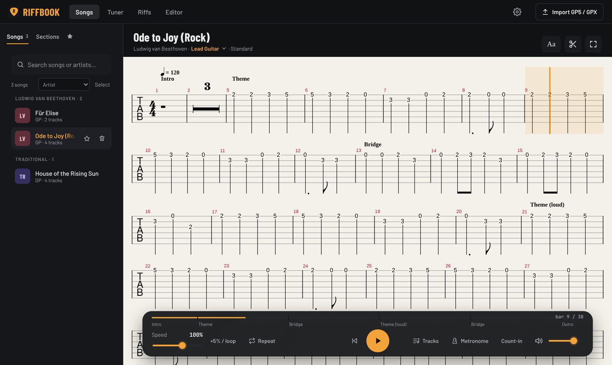
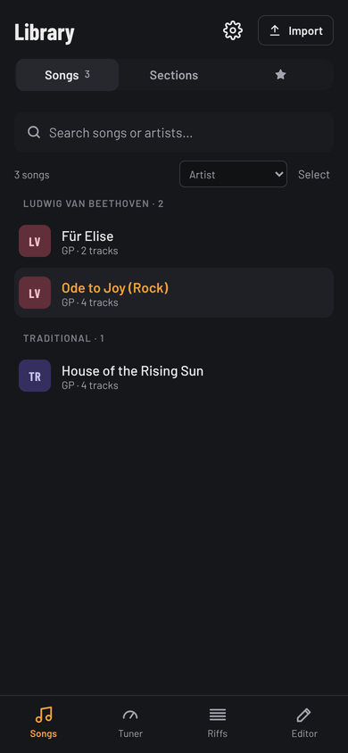
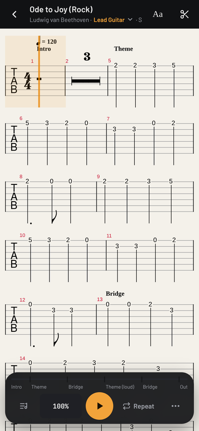
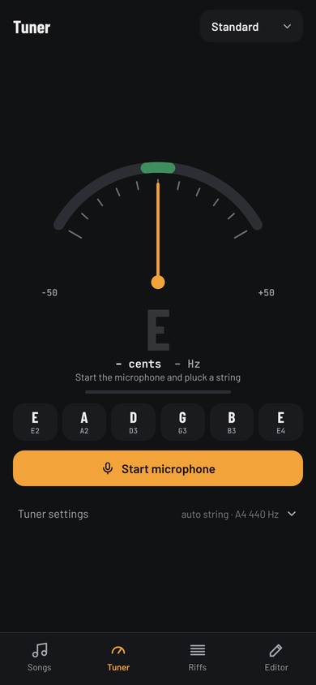
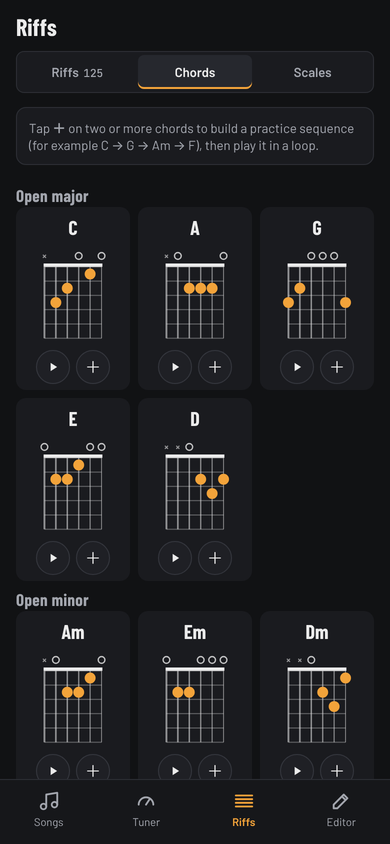

# Riffbook

**Guitar Pro viewer and player in the browser — tabs, tuner, chords and scales. Works offline on PC and phone.**

▶ **Open the app:** https://paulchirila2026.github.io/riffbook/



<p>
  
  
  
  
</p>

Riffbook opens Guitar Pro files (GP3, GP4, GP5, GPX, GP / GP7) and plays them with real instrument sounds. It is made for practising: slow a solo down, loop a few bars, save the parts you are learning, tune your guitar and work through chords and scales. Everything stays on your device — no account, no server.

---

## Features

**Songs**
- Opens **GP3 / GP4 / GP5 / GPX / GP7** files — drag & drop or *Import*
- **Tab, standard notation and fretboard** — show any of them, hide the rest
- **Song map** on the progress bar (Intro, Verse, Solo…) — tap a section to jump there
- **Speed** 25–150 %, **Repeat** or **loop selected bars**, auto speed-up per loop, count-in, metronome
- **Tracks**: switch track, mute / solo, per-track volume, choose the sound (clean, distortion, acoustic…)
- **Saved sections** (e.g. just the solo) and **“Save as riff”**
- **Favourites**, recent songs, library grouped by artist
- Multi-bar rests, adjustable size, cream / white / dark paper, optional lyrics, dynamics and effect labels
- Select bars on a phone by tapping the first and the last bar

**Tuner** — microphone tuner with 10 tunings (Standard, Drop D, Eb, D Standard, Drop C, Drop B, Open G/D/E, DADGAD), reference tone per string, adjustable A4

**Riffs, chords & scales** — 125 warm-up riffs (rock, metal, blues, funk, jazz), ~45 chord diagrams with sound and a chord-change trainer, pentatonic boxes, blues, major / minor scales

**Editor** — write your own riffs on a tab grid (hammer-ons, slides, bends, vibrato, palm mute) and export them as `.gp`

**Sync** — keep the same library (songs, sections, favourites) on PC and phone through a private GitHub repository of your own — see below

**Everywhere** — installable as an app (PWA) on iPhone, Android and desktop, works offline, keeps the screen awake while you play, backup / restore of the whole library in one file

## Demo songs

The library starts with three demo songs, so every feature can be tried right away — multiple tracks, the song map, solo / mute, loops:

- **House of the Rising Sun** — traditional, arpeggios + solo, bass and drums (6/8)
- **Für Elise** — Beethoven, melody and accompaniment (3/8)
- **Ode to Joy (Rock)** — Beethoven, lead, rhythm guitar, bass and drums

The melodies are in the public domain; the arrangements were made for Riffbook. They can be added again from *Settings → Library → Demo songs*.

## Using it

- **Online:** open the link above. On a phone, use *Share → Add to Home Screen* to install it like an app.
- **On your own computer:** download the repository and start it with
  - Windows: `Start Riffbook (Windows).bat`
  - macOS / Linux: `start-riffbook-mac-linux.command`
  (the app needs a small local web server; opening `index.html` directly does not work)
- **On your own web hosting:** upload all files to a folder. `sync.php` is optional — it lets several devices share one library on a PHP host.

The first time, the high-quality sounds (32 MB, in 8 pieces under 5 MB) are downloaded once and kept on the device.

## Sync between devices

Riffbook can keep your library in a **private GitHub repository** that only you can see. Nothing goes to any other server.

1. On GitHub, create a new **private** repository, e.g. `riffbook-data` (empty is fine).
2. Create a **fine-grained personal access token** (*Settings → Developer settings → Personal access tokens → Fine-grained tokens*): *Only select repositories* → `riffbook-data`, permission *Contents: Read and write*.
3. In Riffbook open *Settings → Sync*, enter the repository (`your-name/riffbook-data`) and the token, press *Connect*. Do the same on every device.

After that, changes sync automatically when the app opens and every few minutes. The token stays on the device.

## Building

The app runs from the files as they are. If you change the code in `src/`, rebuild `js/riffbook.js`:

```sh
npm install
npm run build
```

## Project layout

| Path | What it is |
|---|---|
| `index.html`, `css/app.css` | page and styles |
| `src/` | app source (ES modules) → bundled into `js/riffbook.js` |
| `lib/alphatab/` | alphaTab 1.8.4 (renders and plays the scores) |
| `lib/sounds/` | GeneralUser GS sound bank, split into pieces |
| `sw.js`, `manifest.webmanifest`, `icons/` | offline support and app icons |
| `demo/` | the three demo songs (`.gp`) |
| `sync.php` | optional sync between devices on a PHP host |

## License

Riffbook is free software: **GNU General Public License v3.0** — see [LICENSE](LICENSE).
© 2026 Paul Chirilă

Riffbook includes third-party components under their own licenses (alphaTab — MPL-2.0, GeneralUser GS, SONiVOX, Bravura, Barlow and JetBrains Mono fonts). See [THIRD_PARTY_NOTICES.md](THIRD_PARTY_NOTICES.md).

Built by Paul Chirilă together with Claude (Anthropic).
